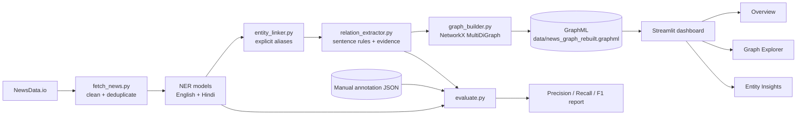
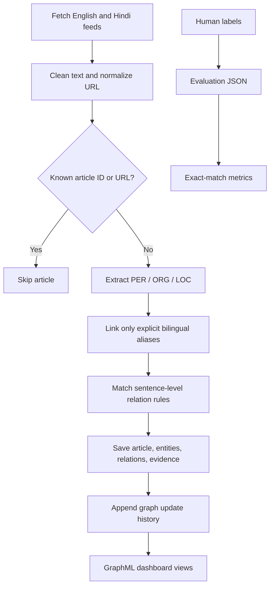

# NEWSGRAPH AI

**Discover the connections behind the news.**

NEWSGRAPH AI is a Python project that collects English and Hindi news, extracts named entities and evidence-backed relations, and stores them in an incrementally updated NetworkX knowledge graph. A Streamlit dashboard provides graph exploration, entity insights, and article activity summaries.

> **Evaluation status:** an annotation template and evaluator are included, but the template contains no labels. No model accuracy is reported until a human annotates evaluation examples.

## What it does

- Fetches latest English (`en`) and Hindi (`hi`) articles for India from NewsData.io.
- Cleans basic HTML and common feed boilerplate, normalizes URLs, and skips duplicates.
- Runs the existing Hugging Face English and Hindi NER models and links a small set of explicitly reviewed aliases.
- Extracts sentence-level relationship candidates with rules, confidence values, and evidence sentences.
- Updates `data/news_graph_rebuilt.graphml` incrementally; processed article IDs and normalized URLs are skipped.
- Provides Overview, Graph Explorer, and Entity Insights pages in Streamlit.
- Evaluates NER and relation extraction against manually supplied JSON annotations.

## Architecture



## Workflow



## Requirements

- Windows, macOS, or Linux with Python 3.10 or newer.
- A NewsData.io API key to fetch live articles.
- Internet access on the first run so Hugging Face can download the two NER models. Cached models can be used offline afterward.
- PyTorch and Transformers model files require substantial disk space and may take time to load. This project does not use a paid NLP API.

## Installation on Windows PowerShell

Run commands from the repository root (`News_kg`):

```powershell
py -3 -m venv .venv
.\.venv\Scripts\python.exe -m pip install --upgrade pip
.\.venv\Scripts\python.exe -m pip install -r requirements.txt
Copy-Item .env.example .env
```

Edit `.env` and set `NEWSDATA_API_KEY` to your own NewsData.io key. Keep `.env` private; it is ignored by `.gitignore`.

If `py -3` selects an unsupported Python installation, create the virtual environment with the Python version you intend to use, for example `py -3.12 -m venv .venv`.

## Run the pipeline

```powershell
.\.venv\Scripts\python.exe src\main.py
```

The pipeline fetches the English and Hindi feeds, skips saved IDs and URLs, and adds only new articles. It writes the graph to `data/news_graph_rebuilt.graphml`. Each successful pipeline invocation appends a timestamped update record to graph metadata. Existing `data/news_graph.graphml` and `data/news_graph_rebuilt.graphml` files are retained; the application reads and updates the rebuilt graph by default.

## Run the dashboard

```powershell
.\.venv\Scripts\python.exe -m streamlit run dashboard\app.py
```

The sidebar provides:

- **Overview:** corpus counts, a focused graph snapshot, English/Hindi distribution, entity type distribution, entity search, recent articles, and saved ingestion updates.
- **Graph Explorer:** a visible focused graph, node selection in the expandable interactive view, entity/relation/language/source filters, and relationship evidence.
- **Entity Insights:** aliases, article mentions, direct connections, relationship evidence, article sources/dates, publication-date trends, and trending entities.

The graph explorer limits the displayed neighborhood instead of drawing the entire graph. A missing or old update-history field is shown as an empty state; it is not inferred from publication dates.

## Manual evaluation

The format is defined in [`data/evaluation_data.schema.json`](data/evaluation_data.schema.json). Start with [`data/evaluation_data.template.json`](data/evaluation_data.template.json), copy it to `data/evaluation_data.json`, and add your own human-reviewed annotations. The supplied template intentionally contains empty arrays and no ground truth.

### Annotation protocol

- `ner_examples`: provide `id`, `language`, original `text`, and an `entities` list. Each entity uses its surface `text` and `type` (`PER`, `ORG`, or `LOC`).
- `relation_examples`: provide `id`, `language`, original `text`, the manually annotated `entities` used as relation-extractor input, and a `relations` list of typed `subject`, `predicate`, and `object` endpoints. Event endpoints use `{"type":"EVENT","event_type":"ANNOUNCEMENT"}` (or another event type emitted by the extractor).
- Annotate from the article text; do not copy system predictions as ground truth. Relation examples use gold entities as input to isolate relation extraction from NER. Optional evidence is kept for annotation review but is not part of the relation score.
- IDs must be unique within each annotation list. Use English labels `en` or Hindi labels `hi`.

Run after adding annotations:

```powershell
.\.venv\Scripts\python.exe src\evaluate.py --input data\evaluation_data.json --output data\evaluation_report.json
```

NER reports separate English and Hindi precision, recall, and F1. Relation output includes overall and language metrics plus per-predicate metrics. Matching is exact after Unicode NFKC, case folding, and whitespace normalization: NER compares surface/type pairs; relations compare typed subject–predicate–object triples. A `null` metric means its denominator is undefined or there are no labels. No scores should be cited until the dataset has reviewed annotations.

## Tests and verification

Run the automated suite (it uses mocked NewsData.io responses and does not spend API credits):

```powershell
.\.venv\Scripts\python.exe -m unittest discover -s tests -v
```

The tests cover fetch cleaning and duplicate handling, incremental graph writes, entity linking and cleanup, relation evidence and event nodes, both existing GraphML files, dashboard data summaries, search/filter helpers, entity insights, and evaluation metric calculations. The live news API is not called by tests.

## Data files

- `data/news_graph.graphml` — original graph, preserved.
- `data/news_graph_rebuilt.graphml` — active graph for updates and dashboard reads.
- `data/sample_news.json` — small sample text file from the original repository; it is not automatically loaded by the live pipeline.
- `data/evaluation_data.template.json` — empty manual annotation template.
- `data/evaluation_data.schema.json` — JSON Schema for annotation structure.

## Limitations

- Relation extraction is a hand-written rule baseline, not a learned or calibrated relation model. Its confidence values are rule scores, not measured probabilities. It can miss paraphrases and misidentify argument direction; review evidence before relying on a relation.
- Cross-language linking is deliberately limited to the explicit aliases in `src/entity_linker.py`. Similar spellings are not enough to merge entities.
- NER quality depends on the selected pretrained models and noisy news text. The generic-term filter is a small heuristic list.
- Actual precision, recall, and F1 are currently unavailable because no human annotation set has been supplied.
- Existing graphs may lack aliases, relation evidence, confidence, or update history. Dashboard views handle missing values, but do not reconstruct missing provenance.
- Dashboard charts and graph helper figures are tested, but the full browser-rendered page was not visually inspected in the constrained verification environment because local browser/server access was blocked.
- Live NewsData.io availability, limits, and article completeness depend on the user’s account and API response.

## Future scope

- Build a balanced, adjudicated English/Hindi gold set and report per-entity and per-relation scores with a documented annotation guide.
- Add reviewed alias candidates and a human correction workflow instead of broad fuzzy merging.
- Expand relation rules using labeled error analysis, then compare against a suitable local model.
- Add automated dashboard browser tests and capture screenshots from the installed application.
- Add a scheduled updater with retry/backoff and persistent run logs if unattended operation is needed.

## Screenshots

No dashboard screenshots are included yet. The project virtual environment has Streamlit and Plotly, but this verification environment could not render a browser session because local app access was blocked. The existing PNG files in `data/` are earlier Matplotlib graph visualizations, not screenshots of this dashboard.
